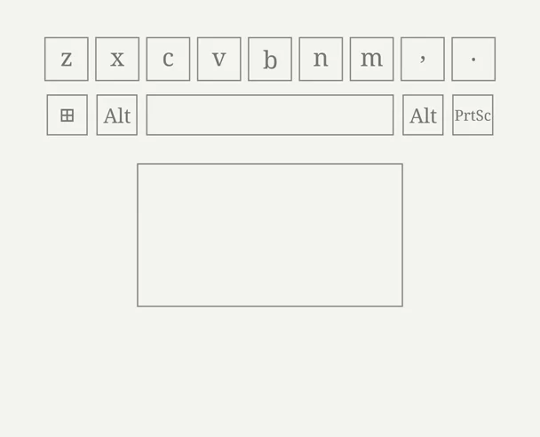

# Upil

Upil (User-driven Pad Interaction Layer) is a Linux touchpad daemon that lets you adjust brightness, volume, and
media position with touchpad gestures. Hold a trigger key and slide a finger
along a touchpad edge to control an action. Release the key to return the
touchpad to normal operation.

Tested on KDE Plasma and DankLinux ([DankMaterialShell](https://danklinux.com/)).
Other desktops are untested — see item 6 in [Background](#background).

<p align="center">
  
</p>

## Use Upil

Hold `RightAlt` (the default trigger key), then slide along an edge:

| Touchpad area | Movement | Default action |
| --- | --- | --- |
| Top 15% | Left or right | Brightness |
| Right 15% | Up or down | Volume (up = louder) |
| Bottom 15% | Left or right | Media seek |
| Left edge | Up or down | Disabled (`none`) |
| Center | Any | No action |

Release your finger, then slide again to continue across the control's range.
This is called *clutching*. Move slowly for precise adjustments or quickly to
cover more of the range. Your desktop may show its usual on-screen display
(OSD) while you adjust a value.

## Before you install

Make sure you have the following:

- Linux and Python 3.11 or later. Check your version with `python3 --version`.
- The Python `evdev` package. Install it with `pip install evdev` or your
  distribution's package manager. On Arch Linux and Fedora, the package is
  commonly named `python-evdev`.
- Permission to read input devices. Your user must belong to the `input` group.
- A supported backend for volume and brightness control.

### Backends

Upil drives hardware directly with standard tools — no desktop shell
required. On DankMaterialShell (DMS), DMS shows its OSD reactively
for every change, with no extra setup. Other desktops are untested.

| Action | Tool | Needed for |
| --- | --- | --- |
| Volume | `wpctl` (PipeWire) | volume slides |
| Brightness | `brightnessctl` (sysfs) | brightness slides |

In `auto` (the default) each action is enabled when its tool exists and
disabled with a clear log line when it does not — the rest keeps working.
Set a driver explicitly (`pipewire`, `brightnessctl`) to abort at startup
instead when the tool is missing, so typos stay loud.

Media seeking uses MPRIS over D-Bus and does not require an additional backend.

## Install and start Upil

Complete these steps in order. Resolve any errors before continuing.

1. Copy the `upil` folder to a location of your choice. This example uses
   `~/Projects/upil`.

2. Add your user to the `input` group:

   ```sh
   sudo usermod -aG input "$USER"
   ```

   Log out and log back in for the group change to take effect. Run `id` and
   confirm that `input` appears in the group list.

3. Make sure `wpctl` and `brightnessctl` are installed. Skip the one whose
   action you do not need — that action disables itself with a log line.

4. Check that Upil can detect the keyboard and touchpad. This check is read-only
   and does not change system settings:

   ```sh
   cd ~/Projects/upil && python3 calibrate.py --no-color
   ```

   The output should list your keyboard and touchpad, including their sizes and
   zones. If the touchpad is missing, see [Troubleshooting](#troubleshooting).

5. Install and enable the systemd user service. The service file contains
   the path to `daemon.py`, so edit it first if your folder is not
   `~/Projects/upil`:

   ```sh
   grep ExecStart ~/Projects/upil/upil.service
   ```

   Change the path after `/usr/bin/python3` to your `daemon.py` location,
   then install:

   ```sh
   mkdir -p ~/.config/systemd/user
   cp ~/Projects/upil/upil.service ~/.config/systemd/user/
   systemctl --user daemon-reload
   systemctl --user enable --now upil.service
   ```

6. Verify that the service is running and check its recent logs:

   ```sh
   systemctl --user status upil.service --no-pager | grep Active
   journalctl --user -u upil.service --no-pager -n 3
   ```

   The status should show `active (running)`. The log should include a line
   similar to `[backend] volume=pipewire brightness=brightnessctl backlight=intel_backlight`.

To stop Upil temporarily, run:

```sh
systemctl --user stop upil.service
```

To disable automatic startup, run:

```sh
systemctl --user disable upil.service
```

## Configure Upil

Upil loads its configuration from the first available source in this order:

1. The path passed with `--config`.
2. `~/.config/upil/config.toml`.
3. `config.toml` in the same directory as the script.
4. Built-in defaults.

To print the configuration that Upil resolves, run:

```sh
python3 daemon.py --print-config
```

Command-line options take priority over values in the configuration file. Key
names follow the `evdev` naming standard, such as `KEY_RIGHTALT`,
`KEY_CAPSLOCK`, and `KEY_MENU`.

### Configuration options

- **`trigger_key` and `trigger_hold_ms`:** Select the trigger key and the time,
  in milliseconds, that it must be held before slide mode starts. Set
  `trigger_hold_ms` to `0` to start slide mode immediately.
- **`[zones]`:** Set the width of each edge zone as a fraction from `0.0` to
  `1.0`. Fractions adapt to different touchpad resolutions, so you do not need
  to enter raw device coordinates.
- **`[mapping]`:** Choose an action for each zone: `brightness`, `volume`,
  `seek`, or `none`. At least one zone must use an action other than `none`.
  The movement direction follows the zone: top and bottom use left-to-right
  movement, while left and right use up-and-down movement.
- **`[scale]`:** Set the adjustment scale for brightness, volume, and media
  seeking. A full slide with a scale of `1.0` represents 100% for brightness
  and volume. `seek_seconds` sets how many seconds a full slide skips. This is
  a fixed duration rather than the track length (`mpris:length`), so a full
  slide does not jump too far in a long podcast. For music, start with `300`
  (about five minutes per full slide). Use `60` to `120` for more precise
  seeking, or `600` or more for long-form content.
- **`[throttle]`:** Controls sampling frequency and noise filtering. `hz` sets
  how often finger movement is sampled (default 20); keep it at `30` or lower.
  Sending to hardware runs on a worker thread at tool speed — latest value
  wins, so a slow tool (`wpctl` takes about 80 ms per call, `brightnessctl`
  about 30 ms) never blocks sampling and never rubber-bands the gesture.
  `quantum` sets the minimum change between
  updates (the default behavior sends an update for every 0.5% change).
  `deadzone` ignores small movements below 0.3%. `max_jump` rejects jumps of
  25% or more in a single event. See [Jump guard](#jump-guard).
- **`[backend]`:** Select the volume driver (`auto` or `pipewire`) and the
  brightness driver (`auto` or `brightnessctl`). `auto` uses the tool when it
  exists and disables only that action when it does not.

## How Upil behaves

### Touchpad access

Upil reads touchpad input only while you hold the trigger key. Reading stops
when you release it. The logs mark these events as `trigger ACTIVE` and
`trigger released`.

While slide mode is active, Upil grabs the touchpad exclusively. This freezes
the pointer so the gesture does not also move the desktop cursor. Releasing the
trigger releases the grab.

### Multi-finger pause

If a second finger touches the pad during a gesture, Upil pauses the adjustment
and keeps the current value. The OSD remains at that value as a visual marker.
When only one finger remains, the gesture resumes from a new baseline to avoid
a sudden jump. The logs show `[touch] pause` and `[touch] resume` at level 0.

### Jump guard

The jump guard rejects a movement of 25% or more in a single event, which lasts
about 5 ms. Such a sudden change may indicate a ghost touch, tap bounce, or a
wet touchpad. Upil ignores the event, resets the movement baseline, and logs
the issue once per touch.

### Device recovery

Upil handles device removal, reconnection, suspend, and resume automatically.
It rescans for devices every two seconds, so you do not need to restart the
service after these events.

### Missing tools

In `auto` mode, a missing tool disables only its own action
(`DISABLED(wpctl)` in the log) while the rest keeps working. An explicitly
requested but missing tool stops the daemon at startup instead, so typos
stay loud.

## Logs and debugging

Log entries use tags such as `[trigger]`, `[touch]`, `[zone]`, `[emit]`,
`[backend]`, `[mpris]`, `[grab]`, `[device]`, and `[config]`.

The default log level (`0`) shows triggers, zones, and errors. Use `-v` to see
values and backend details, or `-vv` to include more touch input details.

Follow the service logs in real time:

```sh
journalctl --user -u upil.service -f
```

Show only emitted updates:

```sh
journalctl --user -u upil.service -f | grep '\[emit\]'
```

To run the daemon in live mode for debugging, stop the service first. Only one
instance of the daemon should run at a time:

```sh
python3 daemon.py --live -v
```

## Troubleshooting

<details>
<summary>Common problems and fixes (daemon silent, grab failed, bad mapping, seek or backends not working)</summary>

| Problem | Possible cause and solution |
| --- | --- |
| The daemon does not respond. | Check that `systemctl --user status upil.service` reports `active (running)`. Make sure only one `daemon.py` process is running with `ps aux | grep '[d]aemon.py'`, and confirm that your user belongs to the `input` group. |
| The log contains `grab ... FAILED`. | Another program may have grabbed the touchpad. Close that program and try again. |
| Startup reports `invalid mapping`. | A mapping value is not one of `brightness`, `volume`, `seek`, or `none`, or every zone is set to `none`. |
| Media seeking does not work. | No MPRIS player may be available on the D-Bus session, or the player may support neither `Seek` nor `SetPosition`. Check for `[mpris] no player on the bus` and review the `[mpris]` log entries. |
| Volume or brightness does not work. | Install `wpctl` (volume) and `brightnessctl` (brightness). A missing tool disables only its own action — check for `DISABLED` in the log. Untested desktops may behave differently; only KDE Plasma and DankLinux are verified. |

</details>

<details>
<summary>Uninstall Upil (removes the service, config, folder, and group membership)</summary>

Complete these steps in order. Each step undoes one install step, so
nothing is left behind.

1. Stop the service and disable automatic startup:

   ```sh
   systemctl --user stop upil.service
   systemctl --user disable upil.service
   ```

2. Remove the installed service file and reload systemd:

   ```sh
   rm ~/.config/systemd/user/upil.service
   systemctl --user daemon-reload
   ```

3. Remove your configuration (optional, skip this to keep your settings):

   ```sh
   rm ~/.config/upil/config.toml
   ```

4. Delete the project folder:

   ```sh
   rm -rf ~/Projects/upil
   ```

5. Remove your user from the `input` group (optional, reversible):

   ```sh
   sudo gpasswd -d "$USER" input
   ```

   Log out and log back in for the change to take effect. Only do this if
   no other program needs direct input access.

</details>

## Project files

- `daemon.py`: Main daemon. The `--live` option enables actions; without it,
  the daemon prints a dry run.
- `calibrate.py`: Read-only tool for inspecting device positions. It does not
  call control backends. It uses fixed 15% zones (top, right, bottom, left)
  and does not read `[zones]`/`[mapping]` from the config.
- `config.toml`: Example configuration.
- `upil.service`: systemd user service definition.
- `tugas.md` and `rencana.md`: Internal project notes in Indonesian.

## Background

<details>
<summary>Planned work and design decisions (for context purposes only)</summary>

### Planned work

The following items are not implemented or fully tested yet:

1. **Per-finger pause handling:** The current pause behavior is coarse. Tracking
   each finger by multitouch slot is not implemented. Known quirk:
   the driver bounces touch on finger-count change, which can re-latch the
   zone mid-gesture during multi-finger use. Harmless in practice; debouncing
   was deliberately skipped.
2. **Brightness control for multiple devices:** The current implementation uses
   the default `brightnessctl` device. External monitors
   controlled through DDC are not supported.
3. **Live testing for `trigger_hold_ms > 0`:** The code path exists but has not
   been tested on real hardware.
4. **Shared device-detection code:** `calibrate.py` and `daemon.py` duplicate
   about 60 lines of device-detection logic. They remain separate for now.
5. **Installation script and `config_version`:** These may be added if the
   project needs a more automated setup or wider distribution.
6. **Broader hardware and desktop testing:** Non-ThinkPad and non-Synaptics
   touchpads have not been tested yet, and neither have desktops other than
   KDE Plasma and DankLinux. Both kinds of testing are still needed to
   confirm portability.
7. **Custom command backends:** A `[command.volume]` / `[command.brightness]`
   section with `get`/`set` command templates (`{percent}` placeholder),
   output regex, and scale — so unknown tools work through config alone,
   without code changes. Design agreed, not implemented.

### Design decisions

- **Fixed-duration media seeking:** Upil does not use `mpris:length` to scale
  seeking, because a full slide could skip too much in long-form content.
- **Direct brightness updates:** Upil uses direct brightness writes rather than
  optimistic OSD updates. Testing showed that a 20 Hz throttle was sufficient.
- **Kept multi-finger pause:** Removing the pause was considered because the
  firmware signal seemed absent. A capture test proved the multitap signal
  does arrive, so pause handling stays, backed by a jump guard as a second
  layer.

</details>
